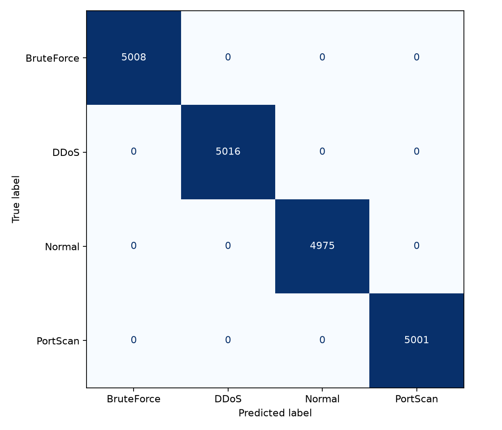

# Resultados — classificacao de ataques

## Dados e divisao

O CSV original tem 100.000 linhas e sete colunas. Nao encontrei valores nulos; removi uma duplicacao exata da copia usada no treino, ficando com 99.999 registos. Usei uma divisao estratificada: 79.999 registos para treino e 20.000 para teste.

## Comparacao em validacao cruzada

A tabela resume a media de tres folds estratificados aplicados apenas aos dados de treino.

| Modelo | Macro-F1 CV | Accuracy CV |
|---|---:|---:|
| Random Forest | 1,0000 | 1,0000 |
| XGBoost | 1,0000 | 1,0000 |
| Arvore de decisao | 1,0000 | 1,0000 |
| k-NN | 0,9997 | 0,9997 |
| SVM linear | 0,9997 | 0,9997 |
| Regressao logistica | 0,9994 | 0,9994 |
| Gaussian Naive Bayes | 0,8062 | 0,8239 |
| Baseline (classe mais frequente) | 0,1002 | 0,2508 |

Ajustei uma arvore por procura aleatoria usando os folds do treino. A arvore ajustada nao superou o Random Forest; selecionei este ultimo antes de consultar o teste.

## Avaliacao no teste retido

| Metrica | Resultado |
|---|---:|
| Accuracy | 1,0000 |
| Macro-F1 | 1,0000 |
| ROC-AUC macro OvR | 1,0000 |
| Diferenca macro-F1 treino-teste | 0,0000 |

| Classe | Precision | Recall | F1 | Suporte |
|---|---:|---:|---:|---:|
| BruteForce | 1,0000 | 1,0000 | 1,0000 | 5.008 |
| DDoS | 1,0000 | 1,0000 | 1,0000 | 5.016 |
| Normal | 1,0000 | 1,0000 | 1,0000 | 4.975 |
| PortScan | 1,0000 | 1,0000 | 1,0000 | 5.001 |

O pipeline treinado esta em `../resultados/modelo_final.joblib`; as metricas estruturadas estao em `../resultados/resumo_resultados.json`.

## Interpretacao e limitacoes

Os resultados perfeitos exigem cautela. No CSV, todos os registos DDoS usam `protocol=TCP` e todos os BruteForce usam `protocol=UDP`. A variavel `failed_logins` e zero em DDoS, Normal e PortScan e varia entre 3 e 10 em BruteForce; estes atributos podem revelar diretamente o rotulo.

A divisao aleatoria avalia apenas registos da mesma fonte. O dataset nao inclui timestamp nem identificador de sessao para testar generalizacao temporal ou por grupos. Nao validei o modelo numa fonte independente e nao recomendo uso operacional com base nestes resultados.

## Reprodutibilidade

O experimento usa a semente `42`, uma divisao estratificada de 80/20 e validacao cruzada estratificada de tres folds no treino. O encoding e o scaling estao dentro dos pipelines avaliados. O teste retido so e usado depois da comparacao e do ajuste dos modelos.
