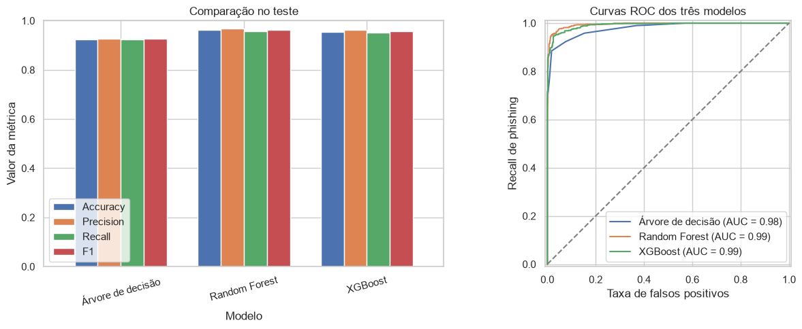
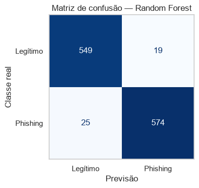

# Resultados do trabalho individual

**Autor:** Nathan · **Turma:** 2ºCIB

Resultados guardados da execução verificada de 13/10/2026, com semente 42. O dataset tinha 11 054 linhas e 30 características. Após retirar o índice e cópias de linhas, ficaram 5 849 exemplos: 4 682 de treino e 1 167 de teste. Há 64 padrões com classes contraditórias; foram mantidos e agrupados para evitar sobreposição entre as divisões.

## Validação dos três modelos principais

Média das três divisões de validação dentro do treino. Accuracy, precision, recall e F1 estão em percentagem; ROC-AUC está entre 0 e 1. A classe positiva é phishing.

| Modelo | Accuracy | Precision | Recall | F1 | ROC-AUC |
|---|---:|---:|---:|---:|---:|
| Árvore de decisão | 90,77% | 93,27% | 88,68% | 90,84% | 0,9694 |
| Random Forest | 94,96% | 95,39% | 94,83% | 95,11% | 0,9909 |
| XGBoost | 93,87% | 94,62% | 93,47% | 94,03% | 0,9870 |

## Teste dos três modelos principais

Todos foram treinados com o mesmo treino e avaliados no mesmo teste reservado. Esta tabela é apresentada após fixar a escolha do modelo pela validação.

| Modelo | Accuracy | Precision | Recall | F1 | ROC-AUC |
|---|---:|---:|---:|---:|---:|
| Árvore de decisão | 92,37% | 92,79% | 92,32% | 92,55% | 0,9792 |
| Random Forest | 96,23% | 96,80% | 95,83% | 96,31% | 0,9946 |
| XGBoost | 95,54% | 96,12% | 95,16% | 95,64% | 0,9919 |

## Erros do modelo escolhido

O Random Forest detetou 574 casos de phishing e deixou passar 25. Sinalizou incorretamente 19 sites legítimos e classificou corretamente os outros 549.

O ajuste de parâmetros encontrou a mesma configuração inicial de Random Forest como melhor opção entre as oito combinações testadas. Não houve melhoria neste ajuste.

## Comparação completa na validação

| Modelo | Accuracy | Precision | Recall | F1 | ROC-AUC |
|---|---:|---:|---:|---:|---:|
| Random Forest | 94,96% | 95,39% | 94,83% | 95,11% | 0,9909 |
| Gradient Boosting | 94,08% | 94,79% | 93,72% | 94,24% | 0,9875 |
| XGBoost | 93,87% | 94,62% | 93,47% | 94,03% | 0,9870 |
| SVM | 93,74% | 94,82% | 92,97% | 93,89% | 0,9813 |
| Regressão logística | 92,14% | 93,04% | 91,65% | 92,34% | 0,9759 |
| KNN | 91,93% | 91,54% | 92,98% | 92,25% | 0,9717 |
| Árvore de decisão | 90,77% | 93,27% | 88,68% | 90,84% | 0,9694 |
| Naive Bayes | 65,42% | 59,92% | 99,96% | 74,93% | 0,9665 |
| Dummy | 51,69% | 51,69% | 100,00% | 68,15% | 0,5000 |

## Comparação completa no teste

| Modelo | Accuracy | Precision | Recall | F1 | ROC-AUC |
|---|---:|---:|---:|---:|---:|
| Dummy | 51,33% | 51,33% | 100,00% | 67,84% | 0,5000 |
| Regressão logística | 91,60% | 92,53% | 90,98% | 91,75% | 0,9775 |
| Árvore de decisão | 92,37% | 92,79% | 92,32% | 92,55% | 0,9792 |
| KNN | 92,89% | 92,16% | 94,16% | 93,15% | 0,9793 |
| Naive Bayes | 64,44% | 59,07% | 100,00% | 74,27% | 0,9711 |
| SVM | 93,83% | 95,20% | 92,65% | 93,91% | 0,9859 |
| Gradient Boosting | 95,37% | 96,11% | 94,82% | 95,46% | 0,9915 |
| XGBoost | 95,54% | 96,12% | 95,16% | 95,64% | 0,9919 |
| Random Forest | 96,23% | 96,80% | 95,83% | 96,31% | 0,9946 |

## Conclusão

O Random Forest teve o maior F1 médio na validação e foi o modelo selecionado. No teste, obteve cerca de 96,2% de accuracy e 95,8% de recall de phishing. Os resultados mostram que o modelo consegue distinguir muitos exemplos deste dataset, mas ainda falha em alguns casos. Não foi avaliado em sites atuais, e não recebe URLs diretamente.

Um recall elevado isoladamente não basta: o Dummy prevê sempre a classe mais frequente e consegue recall de phishing de 100%, mas tem muitos falsos alarmes. Por isso, é necessário olhar também para precision, F1 e as restantes métricas.

Os números completos podem ser consultados em [resumo_resultados.json](../resultados/resumo_resultados.json). O código que os produziu está no [notebook](../notebooks/IAAC_Phishing_Simples.ipynb). As fontes do dataset estão no [README dos dados](../data/README.md).
